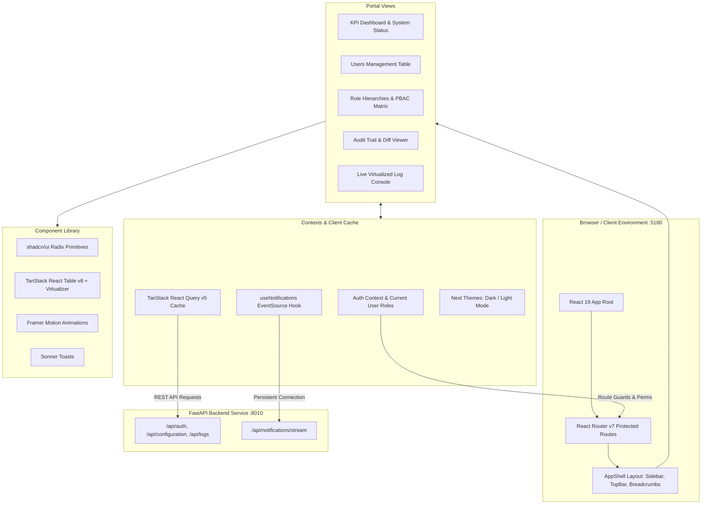

# Marketing Management Portal Frontend (`internal_portal_marketing_front`)

Web + mobile frontend for the ZenaTech Marketing Management portal (event expenses, approvals, budget vs actual, social media). Built with **React 19**, **TypeScript**, **Vite 8**, **Tailwind CSS v4**, **shadcn/ui**, and **Expo / React Native** for the Android/iOS app. Started from `Template_Automation_Front` and converted to a universal app like the CEO Dashboard.

---

## System Architecture Diagram



---

## Technologies & System Specifications

| Category | Technology | Description |
| :--- | :--- | :--- |
| **Framework & Build** | [React 19](https://react.dev/), [Vite 8](https://vitejs.dev/) | Lightning fast ES module builds, pinned port `5180` |
| **Language** | [TypeScript](https://www.typescriptlang.org/) | Strict typings for models, API responses, and prop contracts |
| **Styling & Theme** | [Tailwind CSS v4](https://tailwindcss.com/), `@shadcn/react`, `next-themes` | Modern utility CSS with custom CSS variables and dark mode support |
| **Data Fetching & Cache**| [TanStack React Query v5](https://tanstack.com/query) | Stale-time caching, automatic retries, and optimistic mutations |
| **Tables & Virtualization** | [TanStack React Table v8](https://tanstack.com/table), [TanStack Virtual](https://tanstack.com/virtual) | High-performance virtualized grids capable of rendering thousands of audit records |
| **Drag & Drop** | `@hello-pangea/dnd` | Smooth drag-and-drop lists and ordering controls |
| **Routing & Protection** | [React Router v7](https://reactrouter.com/) | Protected route guards checking PBAC navigation codes and action permissions |
| **Animations & UI Primitives** | [Framer Motion](https://www.framer.com/motion/), `sonner`, `vaul`, Radix UI | Toasts, animated drawers, accessible dialogs, and popovers |
| **Excel & Export** | `exceljs`, `date-fns`, `clsx`, `tailwind-merge` | Client-side spreadsheet generation and export utilities |

---

## Core Features & Workflows

1. **Role-Based Access Control (RBAC & PBAC)**:
   - User assignment, group action matrix (View, Create, Edit, Delete), and route method enforcement.
2. **Microsoft Entra ID SSO**:
   - Single sign-on with token exchange and automatic access status evaluation (`/pending-access`).
3. **AppShell Architecture**:
   - Collapsible permission-filtered sidebar, live connection health indicator, dynamic breadcrumbs, and notification tray.
4. **Real-Time Notification Center**:
   - Zero-overhead SSE listener with automatic reconnection, heartbeat pings, and toast alerts.
5. **Observability & Log Inspection**:
   - Filterable audit trail with JSON payload diff viewer and live application console logs.

---

## Directory Structure

```text
internal_portal_marketing_front/
├── public/                 # Static assets, branding, and icons
├── src/
│   ├── components/         # Shared UI components
│   │   ├── AppShell/       # Sidebar, TopBar, Breadcrumbs, Notifications
│   │   ├── Configurations/ # RBAC permission modals and dialogs
│   │   └── ui/             # shadcn/ui primitive library
│   ├── hooks/              # Custom hooks (useSSE, useAuth, useAuditLogs)
│   ├── lib/                # AuthContext and helper utilities
│   ├── pages/
│   │   ├── Configurations/ # Users, Roles, and Permission matrices
│   │   ├── Log/            # Audit logs page
│   │   ├── Logs/           # System logs console
│   │   ├── Dashboard.tsx   # Portal overview
│   │   └── Login.tsx       # Microsoft SSO login
│   ├── services/           # apiClient, queryKeys, error reporting
│   ├── types/              # Domain TypeScript types
│   ├── App.tsx             # Application router
│   └── main.tsx            # Entry point
├── package.json
└── vite.config.ts          # Vite configuration pinned to port 5180
```

---

## Getting Started

### 1. Install Dependencies
```bash
npm install
```

### 2. Environment Variables (.env)
Copy `.env.example` to `.env`:
```env
# Backend API Base URL (FastAPI running on port 8010)
VITE_API_BASE_URL=http://localhost:8010
# Mobile (Expo inlines EXPO_PUBLIC_* at bundle time)
EXPO_PUBLIC_API_BASE_URL=http://localhost:8010
```

### 3. Run Development Server
```bash
npm run dev      # web only
npm start        # web (Vite :5180) + mobile bundler (Expo Metro :8091)
```
Open application at `http://localhost:5180`.

### 4. Run on Android
Requires Android Studio with an emulator (AVD). `Pixel_7` is preferred, otherwise the first AVD found.
```bash
npm run android  # boots the emulator, sets adb reverse for 8091/8010/5180, starts Expo
npm run reload   # reload the app on a running emulator
```
Mobile screens live in `src/**/*.native.tsx` (entry: `index.js` → `src/App.native.tsx`). In development, sign in with the **Dev Sign In** button (calls `POST /api/auth/dev-login`); Microsoft SSO on mobile is not wired up yet.

### 5. Build for Production
```bash
npm run build
```

### 6. Lint
```bash
npm run lint
```
